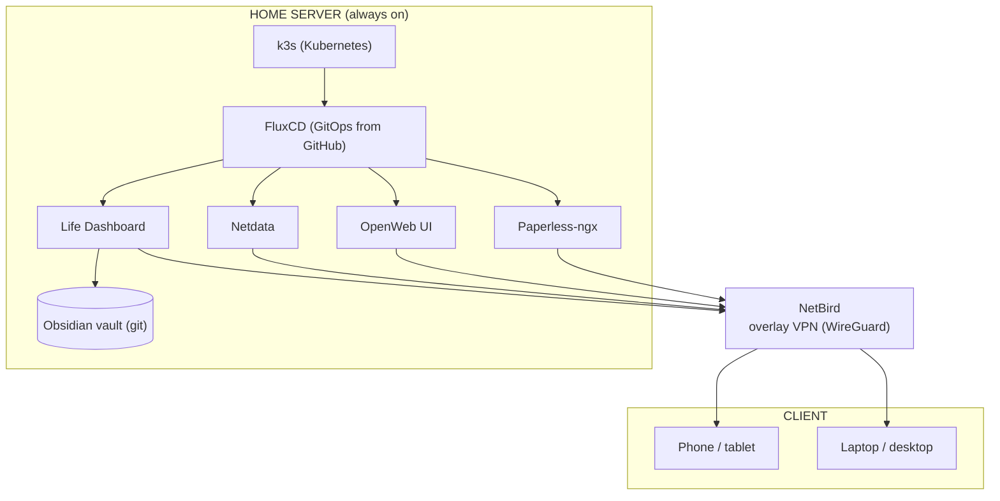
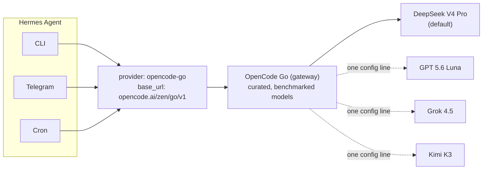
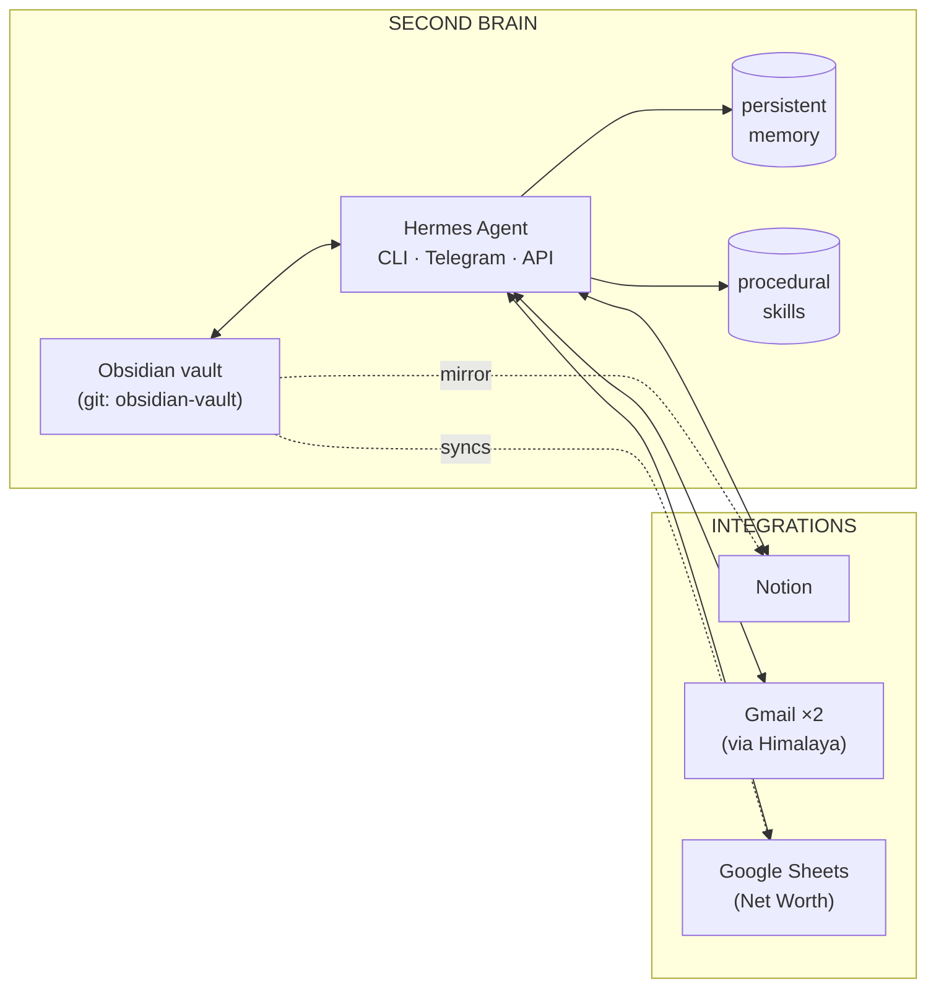

The starting point was a data set spread across three separate locations, with no communication between them. Projects, notes and media files had accumulated to the point where manual organization was no longer feasible.

The solution was to consolidate everything onto a single, purpose-built self-hosted server. The system unifies three components that are usually kept separate: [k3s](https://k3s.io/), a lightweight Kubernetes distribution as the orchestration layer; [Obsidian](https://obsidian.md/) as the knowledge base that holds the system's content; and [Hermes Agent](https://hermes-agent.nousresearch.com/), an AI agent that runs inside the system and handles repetitive work autonomously.

This article documents how the pieces fit together. It is intended for anyone who self-hosts, who works inside Obsidian, or who is evaluating whether a locally hosted AI agent is preferable to delegating data and computation to a third-party cloud.

## The architecture at a glance



## The hardware and k3s

The hardware is the first decision, and it constrains everything downstream. Prebuilt NAS devices with proprietary operating systems were ruled out, since they dictate what can and cannot be installed. The requirement was a generic machine: quiet, low power, and suitable for continuous operation.

A small machine meets all of these requirements: no rack, no audible fans, and a measured power draw of 1.49 W idle and 11.13 W under load (stress --cpu 8). It runs continuously and unattended.

On top of it runs [k3s](https://k3s.io/), a lightweight Kubernetes distribution packaged as a single binary. It exposes the full Kubernetes API (pods, deployments, services, persistent volumes) at a fraction of the footprint of a standard control plane, which matters on a small machine. The workloads are ordinary containers, but they are declared, scheduled and supervised the way production workloads are.

The second layer is [FluxCD](https://fluxcd.io/), a GitOps controller that reconciles the cluster against a private GitHub repository. Every service on the machine is a set of manifests in that repository; Flux watches the repo and drives the cluster toward the declared state. A change to the infrastructure is a commit rather than a shell command. The repository is the source of truth, and the cluster is a projection of it. Reproducibility is a property of the setup rather than a practice.

## Obsidian, the second brain

The data side of the system is an Obsidian vault, versioned with git and synchronized to GitHub.

The structure is designed so that the placement of any piece of information is immediately obvious. Every area of life has its own folder: finance, work, university, sport, music, flight simulation, books, articles, recipes. A dedicated "Me" section holds material that concerns the user as a person rather than as a project.

The folder organization, however, is secondary. What matters is that the vault is a single, queryable archive. Each month's finances are markdown files with YAML frontmatter. Daily notes are dated. Work projects have their own space. Because the entire content is plain text inside a git repository, it is robust, diffable, and independent of any proprietary format that might one day become unreadable.


This is the foundation. Obsidian is not merely a note-taking application: it is the central record of the system's data, in a format that a human can read. Equally important, it is a format that a machine can read. That second property enables the next component.

## The Life Dashboard

Obsidian is where the data resides, but a store that only accumulates has limited value. The Life Dashboard is the component that surfaces it.

It is a static site served from the cluster, built into a container image by GitHub Actions. Its content is regenerated every fifteen minutes by a Kubernetes CronJob that opens the vault read-only, reads the YAML frontmatter of the finance, sport and books notes, and rebuilds the pages: monthly balances, training sessions, pages read. Nothing is entered by hand. The dashboard is a projection of the notes, never a second source of truth.

The direction of the data flow is the point. The dashboard owns nothing: it reads from the vault and renders a static site. If it is deleted, the next run of the job rebuilds it from the notes. If a number looks wrong, the fix happens in the note, not in the dashboard. The vault remains the single source, and the dashboard is one more way of looking at it.

Access to all services is protected by HTTP Basic authentication on the local network. For remote access, [NetBird](https://netbird.io) provides a WireGuard-based overlay VPN that assigns a static private IP to the server, so every service is reachable from outside without exposing ports on the router. A private domain name points at that overlay IP, so a name is used instead of an address; it resolves only to something reachable from devices on the NetBird network, and it is plain HTTP, since the tunnel is already encrypted. Separately, OpenWeb UI provides a browser interface for chatting with a model; it is mentioned for completeness, since it is a convenience rather than a load-bearing part of the system.

## Paperless-ngx, the document archive

The vault holds notes, not scans. Contracts, invoices, tax forms and medical reports are PDFs and photos, and they used to sit in folders where nothing could find them. [Paperless-ngx](https://docs.paperless-ngx.com/) is the component that fixes this: it ingests a file, runs OCR on it (Italian and English), and makes the text searchable, with tags, correspondents and document types on top.

It runs as a single pod, declared like everything else in the GitOps repository. Redis, which Paperless uses only as an internal task queue, is a sidecar in the same pod without persistence, and the database is SQLite rather than Postgres: for a personal archive, one fewer service to run is the better trade-off. All state lives on one persistent volume: the database, the search index and the documents.

The storage model is what makes it easy to trust. Originals are saved untouched, as ordinary files (the same PDF or JPG that was uploaded, renamed with a numeric ID), and the OCR'd PDF/A copies and thumbnails are derived from them and can be regenerated. Titles, tags and the extracted text live in the database. Original files plus the database are therefore enough to rebuild the whole archive.

Like the dashboard, it runs on the host network so that it is reachable through NetBird, on its own port, and is accessed by name or IP indifferently.

## Backups

Both stateful services take a backup every day, with a Kubernetes CronJob each:

- **Life Dashboard** copies its SQLite database with `sqlite3 .backup`, which gives a consistent snapshot while the service is running, and keeps the last fourteen.
- **Paperless** does the same for its database, and additionally mirrors the original documents incrementally. Deletions are deliberately not propagated, so removing a document by mistake does not remove its backup. Derived data (OCR archives, thumbnails, the search index) is not backed up, because it can be rebuilt.

The CronJobs write to a folder on the host. A local copy does not survive the disk failing, so a second stage moves it off the machine: a Hermes cron job, configured as `no_agent`, so that it runs a plain script on a schedule without involving the model, encrypts the backup folders and uploads them to a cloud drive. The encryption happens before the upload, so the drive only ever holds opaque files; the documents are the kind of data that should not be readable by the storage provider. The upload only adds files and never mirrors deletions, for the same reason as above.

## Hermes Agent, the executive layer

Hermes Agent is an open-source agent framework developed by Nous Research. It belongs to the same category as Claude Code and Codex, with one decisive distinction: it is not bound to a single provider, it runs anywhere, and its scope extends well beyond code generation.

It combines four capabilities:

**Skills.** Hermes learns procedures. When a complex task succeeds, it is saved as a reusable skill that is loaded again in future sessions. A skill is not a prompt; it is procedural memory, a recorded sequence of steps, commands and pitfalls extracted from a task that worked. Skills exist for the vault workflow, the Google APIs, Notion and monitoring. Each time a new procedure is discovered, it is encoded once and remains available afterwards.

**Persistent memory.** Hermes retains facts across sessions. It holds the user's identity, role, preferences and environment details. It does not restart from an empty state at each session like a stateless chatbot. This is the distinction between a tool and a collaborator.

**Multi-platform gateway.** The same agent runs in several places: terminal, Telegram, API. It is not confined to a single window. It can be reached from Telegram while away from the machine, and it operates on the same hardware with the same tools.

**Real tools and integrations.** Terminal, filesystem, browser, MCP servers, cron. It does not only respond; it acts. Through MCP it communicates with Notion, through scripts with the Google APIs, and it holds direct access to the filesystem and the shell.

The configuration that matters is deliberately minimal:

```yaml
model:
  default: deepseek-v4-pro
  provider: opencode-go
  base_url: https://opencode.ai/zen/go/v1
  api_mode: chat_completions
```

Three lines: a model, a provider and an endpoint. Everything else is Hermes operating around those three lines.

### How memory works

Two mechanisms give Hermes its continuity: persistent memory and skills, and they serve different purposes. Persistent memory stores facts, while skills store procedures.

Persistent memory is divided into two stores. The first describes who the user is: identity, role, background and stable preferences. The second holds the agent's own notes about the environment: conventions, tool behaviour and lessons learned. Both are injected into the context of every session, which is why they remain compact and high-signal. Memory is written declaratively, as facts rather than as instructions, and it operates under a fixed budget, so entries that become stale are replaced instead of being allowed to accumulate. The result is a small, always-present layer of context that removes the need to re-explain the same things at every interaction. The memory backend is also pluggable, so the storage behind this layer can be swapped without changing how the agent uses it.

Session recall is a separate capability. Beyond the compressed memory, Hermes indexes the full transcript of every past session in a SQLite store with full-text search. When a reference to earlier work appears, the agent retrieves the relevant conversation rather than asking the user to repeat it. Memory is therefore the distilled layer, and session history is the complete record behind it.

### Self-improvement

The skills system is what makes Hermes self-improving. When a task proves non-trivial, when errors were overcome or an approach was corrected along the way, the resulting procedure is saved as a skill and becomes available to every future session. This is not static documentation: a skill is maintained like code. When a skill is found to be outdated, incomplete or wrong during use, it is patched immediately rather than left to mislead the next session. Overlapping skills can be consolidated, and protected ones are prevented from accidental deletion.

In practice, the set of procedures grows over time. Each solved problem that matches a recurring pattern increases the number of tasks the agent can execute reliably without supervision, and each correction improves the procedures it already has. Procedural knowledge therefore accumulates across sessions and across the interfaces the agent runs on.

### Auxiliary tasks

Not every step of the loop deserves the same model. Hermes separates the main agent loop from a set of auxiliary tasks that run in the background: image analysis, context compression and session search. Each of these can be pointed at its own model instead of inheriting the default.

| Task | Model (OpenCode Go) | Why |
|---|---|---|
| Main loop | DeepSeek V4 Pro | reasoning and tool calling |
| Vision | GPT 5.6 Luna | multimodal |
| Compression | DeepSeek V4 Flash | fast, inexpensive |
| Session search | MiMo-V2.5 | lightweight, retrieval |

The rationale is the same one behind the whole setup: reserve the strong model for the work that requires it, and run routine background tasks on models sized for that work. A single default works, but it pays main-loop prices for background jobs.

## OpenCode Go as provider

This is the most consequential architectural decision in the setup.

The provider is not DeepSeek, Anthropic or OpenAI; it is [OpenCode Go](https://opencode.ai/).

The core problem with models is that there are dozens of them, they change monthly, and most of them perform poorly as agents. A model can be excellent at chat and mediocre when it has to call tools, read files and make decisions across a 150-turn loop. With a direct provider, one is locked into whatever that provider exposes, and the arrival of a better model forces a reimplementation of the integration.

OpenCode Go is a curated gateway: a catalog of models tested and benchmarked by the OpenCode team specifically for agent work. It is not a generic aggregator of the OpenRouter kind, where models are offered with no guarantee beyond availability. These models are verified, discussed with the providers, and served in the configuration that works.

In practice it provides three things.

**One key, every model.** The default is DeepSeek V4 Pro, but the catalog includes Grok, GPT, GLM, Kimi, Qwen, MiniMax, DeepSeek and others. Switching models does not mean switching provider, API key or integration: it means changing a name in a configuration file. A single line switches the model.

**Transparent pricing, no markup.** Billing is per token, pay-as-you-go, with prices published openly. DeepSeek V4 Pro costs approximately $1.74 per million input tokens, and a free tier is also available. In practice, the OpenCode Go bill is about $10 a month (roughly €8.60).

**Built for agents, not chat.** The purpose of OpenCode Go is precisely this use case: models that remain coherent across many turns, call tools reliably and do not drift. It is not a collection of polished chatbots; it is a selection of models capable of sustaining an agent.

It is also not bound to Hermes or to OpenCode. The gateway exposes OpenAI-compatible endpoints, so the same setup can be pointed at any client. It currently runs with Hermes, but it can be pointed at another client without changing the subscription.



## Monitoring: Netdata

Monitoring is [Netdata](https://www.netdata.cloud/), a real-time agent that runs as a DaemonSet on the cluster with host-level access. It reads /proc and /sys directly, so it sees CPU, memory, disk, network and every process and container on the machine without an intermediate exporter.

Netdata is deliberately different from the Prometheus and Grafana combination used at work. Prometheus collects and stores series for later querying; Netdata streams the current state at sub-second resolution. For a single home server the second model is the right fit: there is nothing to provision, no storage to size, and the dashboard exists as soon as the agent starts.

Above the dashboards there is a further layer. Hermes runs a cron job that checks the server's resources every thirty minutes: CPU, RAM, disk, temperature, swap. When everything stays under threshold, it remains silent. When a metric exceeds its limit, it sends a Telegram message with the alert and the processes consuming the most.

Netdata shows the current state; the agent signals when attention is required. These are two layers of the same problem, one for inspection and one for reaction. The second does not require looking at a screen.

## What runs autonomously

The most valuable component requires no presence. The Hermes cron performs a substantial amount of work autonomously.

**Weekly email recap.** Every Monday morning the agent reviews both Gmail accounts through [Himalaya](https://github.com/pimalaya/himalaya), filters out notifications, newsletters and LinkedIn, and summarizes only the messages that require attention.

**Monthly net worth.** At the end of each month it extracts financial data from the Obsidian vault and writes it into the net worth Google Sheet, updating the month's columns. A process that used to require half an hour of manual copy-and-paste is now a scheduled job.

**Timely reminders.** On the tenth of each month it reminds the user of the recurring transfers. It is not a generic calendar: it is a message that arrives when needed, with the correct context.

The common pattern is repetitive, well-defined work that reads from one source and writes to another. It is the kind of task appropriately delegated to an agent rather than performed manually.

## The complete system



The complete system is not a server, a note-taking application or an AI agent in isolation; it is the three combined. Obsidian is the long-term memory, structured and versioned. Hermes is the executive layer, reading, transforming and moving data between systems. The server is the host on which both run, always on and always reachable.

The most valuable property of this setup is that every component is replaceable. Obsidian is plain markdown in a git repository. Hermes is provider-agnostic, and the model can be changed with a single line. The services are git manifests reconciled by Flux, so the entire cluster can be rebuilt from the repository on any machine. There is no lock-in, no proprietary format, and no dependency on a service that can be discontinued.

In the background, the machine keeps the notes in order, supervises the accounts and verifies that the services remain operational. It notifies the user only when something requires attention.

That is the most accurate definition of a second brain encountered so far.
