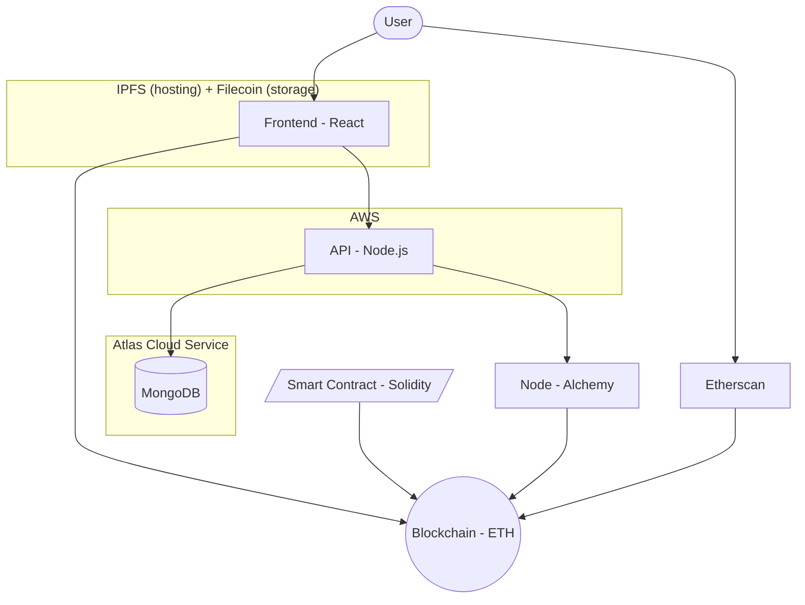
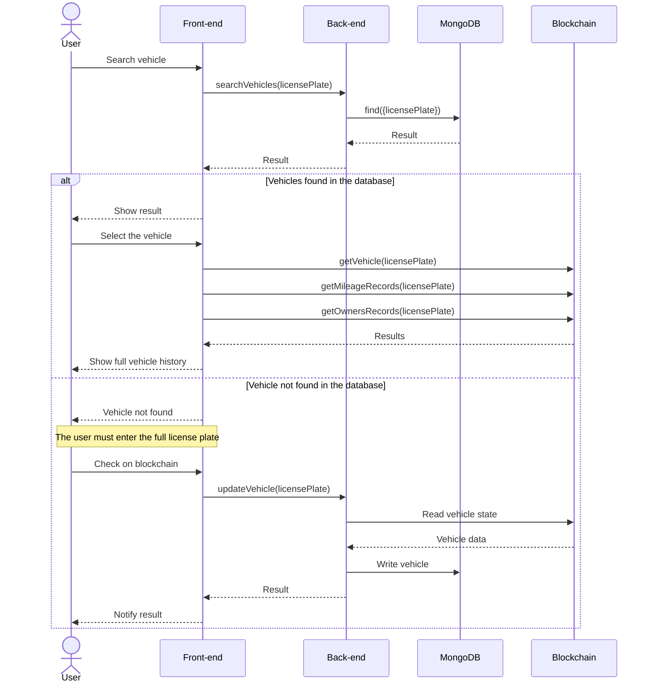

My bachelor's thesis was a blockchain project. Between 2021 and 2023 many systems were built on a blockchain without needing one, and this was one of them. I am writing about it now because some of the engineering is still worth documenting, and because the premise has a flaw that I did not see clearly at the time.

The problem we chose was real. Odometer fraud: a used car shows 90,000 km on the dashboard, has done 180,000, and the seller keeps the difference in resale value. A European Parliament research study puts the share of domestic used-car sales affected by mileage tampering between 5 and 12 percent, and considerably higher for cross-border sales, where estimates reach a third or more. Tampering with a physical odometer costs a few tens of euros, a laptop and an OBD cable. The record is easy to edit, and whoever holds the record is the person with an incentive to edit it.

The proposed solution was to put the mileage history on a public ledger and make the record append-only. We built it as a Solidity contract on Ethereum with a Next.js frontend, called it MileChain, and wrote a performance analysis of it.

## What we built

The system is small. One contract, `MileChain.sol`, stores three mappings keyed by license plate:

```solidity
mapping(string => Vehicle) private _vehicles;
mapping(string => MileageRecord[]) private _mileageRecords;
mapping(string => OwnersRecord[]) private _ownersRecords;
```

It has three write functions (`addVehicle`, `updateMileage`, `changeOwner`) and three read functions. A second contract, `Owned.sol`, handles administration. The rest of the system is a React frontend served on IPFS, a set of Node serverless endpoints, MongoDB, and Alchemy as RPC provider.



*Architecture. The user interacts with the frontend, which talks to the chain through the user's wallet. A separate backend keeps a database in sync with the chain.*

The rules enforced by the contract are the only guarantees the system provides. A vehicle can be registered only once. Only the current owner can update the mileage or transfer the vehicle. A new mileage reading must be strictly greater than the current one:

```solidity
function updateMileage(string memory licensePlate, uint256 mileage) public {
    if (_vehicles[licensePlate].owner == address(0)) revert VehicleNotFound();
    if (_vehicles[licensePlate].owner != msg.sender) revert VehicleOfAnotherOwner();
    if (mileage <= _vehicles[licensePlate].mileage) revert InvalidMileage();
    if (_safeMode) revert SafeModeEnabled();

    _vehicles[licensePlate].mileage = mileage;
    _mileageRecords[licensePlate].push(MileageRecord(mileage, block.timestamp));
}
```

This monotonicity check is the only fraud prevention in the codebase: a value cannot be lowered once it is written. What it does and does not guarantee is covered in the last sections.


*A vehicle page. The timeline is read directly from the chain and shows every mileage record and ownership transfer with timestamps.*

## The need for a centralized database

The first problem appeared early and had nothing to do with cryptography.

Solidity mappings are hash tables. Lookup by key is constant-time and does not degrade as data grows, which is what `getVehicle("CG345IW")` needs. The limitation is that a mapping cannot be enumerated, counted or queried. It only answers the question "what is stored at this exact key".

This rules out several basic features. A search box with partial matches is not possible. A counter of registered vehicles on the homepage is not possible. A list of the vehicles owned by an address is not possible. Each of them requires a scan or an index, and the storage does not support either.

The contract could maintain its own arrays next to the mappings, but every storage write in the EVM costs gas, and the user pays for it. An index that is free in a traditional database becomes a cost on each transaction.

We placed MongoDB next to the chain and used it as a read model. Search, counts and listings are served by the database. When the authoritative history of a specific vehicle is needed, the frontend reads it directly from the chain.

This is a significant concession. The application is decentralized in its trust model and centralized in its usability. If the database is turned off, the contract keeps working, but the product is unusable for anyone who does not already know the exact license plate. Most decentralized applications have an equivalent component, usually called an indexer.

## Keeping the two stores consistent

Two stores can disagree, so a reconciliation policy is needed. Two decisions are still valid.

The first is the direction of authority. The chain is the source of truth and the database is always derived from it. After a successful on-chain write, the frontend does not send the new data to the backend. It sends only the license plate, and the backend reads the current state from the chain and writes it to MongoDB.

```typescript
const handleSuccess = async (tx) => {
    await tx.wait(1);
    Notify.success("Vehicle added successfully!");
    await fetch(`${baseUrl}updateVehicle?chainId=${chainId}&licensePlate=${licensePlate}`)
        .then((res) => res.json())
        .then((data) => Notify.success("Database Updated!"));
}
```

This adds one request to Alchemy per write. In exchange, no client-supplied value enters the write path, so there is nothing to validate or sanitize, and a caller cannot corrupt the read model through the endpoint. The only input of the endpoint is a key.

The same approach is used in non-blockchain systems, for example webhooks that carry only an id and require the receiver to fetch the resource again. If the receiver re-reads from the authority, the message does not need to be trusted.

The second decision is the handling of cache misses. The frontend can be bypassed, for example by calling the contract through Etherscan, in which case the chain contains data the database has never seen. A search that finds nothing in MongoDB therefore offers a second step: look up the full plate on chain and, if the vehicle exists, write it to the database and return it.



*Search. The database serves the fast path. On a miss the query goes to the chain and the read model is updated on the way back.*

This is a read-through cache with repair on miss, where the backing store is a blockchain. The pattern is ordinary, and the problems are the same as in systems that do not use a blockchain.

## Authentication

One thing is simpler in this model. There is no signup, password storage, session, token or password reset flow. The user's wallet signs transactions and the contract compares `msg.sender` with the stored owner address. Authorization is a single comparison inside the function that needs it.

One requirement still exists off chain. Users can attach a display name and a short bio to their address. These fields exist only in the database, and the contract does not know about them, so there is no owner check to rely on.

We hash the user's address concatenated with a secret shared between frontend and backend, and send the result in a header over HTTPS. The server recomputes the hash and compares it. The thesis states that this is weaker than a proper authentication server. The secret is shipped inside a publicly served frontend and can be extracted, which allows setting a display name for an address one does not control. The risk is accepted because the affected fields are decorative and nothing relevant depends on them.

This is the point where the model stops helping. Wallet-based authentication works for actions on chain and does nothing for requests to a server. Any product with state outside the chain needs its own authentication system, and has fewer tools available than a conventional one.

## Safe mode

`Owned.sol` lets a small set of addresses, called deployers to distinguish them from vehicle owners, put the contract in a read-only `safeMode`. Every write function checks it. Reads always work.

It is a circuit breaker: if a vulnerability is found or something breaks upstream, writes can be stopped without asking anyone. Its limit is structural. Safe mode blocks new writes but cannot alter, correct or remove data that was already written, because that is what immutability means. If a bug causes wrong data to be recorded, freezing the contract keeps that data permanently.

Immutability is usually presented as a security property. It is also an operational constraint, and it has to be considered in the incident response plan.

## Gas

One optimization is worth describing because its mechanism is not obvious. The contract originally used `require` with string messages:

```solidity
require(_vehicles[licensePlate].owner == address(0), "Vehicle already exists");
```

Each string is stored in the deployed bytecode. Solidity 0.8.4 introduced custom errors, which are declared once and identified by a four-byte selector:

```solidity
error VehicleAlreadyExists();
// ...
if (_vehicles[licensePlate].owner != address(0)) revert VehicleAlreadyExists();
```

Replacing them throughout reduced the deployment cost from roughly 2.50M to 2.18M gas, about 13 percent, with no change in behavior. Only the tests had to change: `revertedWith("...")` became `revertedWithCustomError(milechain, "VehicleAlreadyExists")`.

Gas is a unit of execution, not a fee added on top of it: one gas is one step of work in the EVM. A cheaper contract is therefore also a faster one, so cost and latency are not in conflict.

## Benchmarks

We generated a dataset of 1,000 vehicles with 2 to 10 mileage updates each, about 6,500 write transactions, and ran it in three configurations.

**Chain only, sequential.** 583 seconds, with a mean of about 90 ms per operation and a standard deviation below 20 ms. The relevant result is the trend, not the absolute value: adding the six-thousandth vehicle costs the same as adding the first, with no drift. This is the expected behavior of a hash table. A design with contract-side arrays would have degraded visibly in this test.

**Full architecture, sequential.** 844 seconds. The trend is equally flat, shifted up by a constant.


*Chain only compared with the full stack. The database round trip adds a constant ~40 ms to every write and does not change the shape of the distribution.*

The 40 ms is the cost of the read model, paid once per write, and it provides search, counters and listings. Compared with the alternatives (no search, or on-chain indexes paid with user gas) it is an acceptable trade-off.

**Concurrent, four Node worker threads.** 589 seconds. Mean latency per operation increased from 129 ms to 358 ms, while throughput increased from 7.7 to 11 transactions per second.


*Four threads. Total time decreased by 255 seconds, while per-transaction latency almost tripled.*

This is the difference between latency and throughput. In the sequential run each component is idle most of the time: the API waits while the node mines, and the node waits while the API works. Running requests concurrently fills these idle periods, so each request queues behind others and takes longer, while the system as a whole finishes sooner. Which number matters depends on whether a user is waiting for a single response.

We then varied the thread count from 1 to 8 to find the limit.


*Throughput against concurrency. It increases up to about 11 transactions per second at four threads and does not increase further.*

Beyond four threads there is no trend, only variation around 10. The thesis states, but does not stress enough, that **these tests ran against a local Hardhat node on a laptop**. What saturates at four threads is a single machine producing blocks. The figure describes the test setup, not Ethereum.

On real infrastructure the behavior is different. A write on Ethereum mainnet does not take 129 ms: it has to be included in a block and then confirmed, so the latency seen by the user is between seconds and minutes, and finality is probabilistic. Each write also has a real cost, paid by whoever submits it. A product built on this has to be designed around a write path that is slow, expensive and only eventually final, and client-side concurrency does not change that.

If I rewrote the performance chapter I would keep all the measurements, because the flat scaling and the constant 40 ms are valid results about the design. I would state explicitly that the throughput limit depends on the laptop.

## What the system cannot do

This section explains the title.

Everything described so far works as designed. The contract enforces its invariants, the read model cannot be corrupted, performance scales flat, and mileage cannot be decreased. The fraud the system was built to prevent is however almost unaffected, for one reason: **the person who enters the mileage is the person with an incentive to falsify it.**

The architecture has no odometer sensor, inspection authority, service center or oracle. A vehicle enters the system when its owner registers it with the mileage the owner declares, and it accumulates history when the same owner submits new readings. The contract refuses to let a number decrease. It cannot know whether the number that was entered was ever true.

The guarantee provided is therefore narrower than the one advertised. The system guarantees that recorded claims cannot be altered afterwards. The problem requires that the claims match physical reality. These are different properties, and only the second prevents fraud. If the odometer is rolled back before registration and 90,000 km is declared, the result is a record that cannot be modified and is false. This is arguably worse than a paper service book, because it looks authoritative.

The conclusion of the thesis acknowledges the limitation and proposes three mitigations: cross-checking with an external database such as the national vehicle registry, adding user reputation and feedback, and adding an escrow or guarantee that reimburses the buyer if the declared mileage turns out to be false. Each of them introduces a trusted third party. The registry is an authority, reputation is an authority made of other people's judgments, and escrow is an authority holding the money. The solution to the impossibility of verifying the input is a party that can verify it, and once that party exists, most of the reason for a trustless ledger is gone.

The remaining requirements are a record that cannot be altered retroactively and knowing who wrote each entry. Both are satisfied by an append-only log with signed entries and a published hash chain, operated by the institution that is already authoritative on vehicles in the country. This needs no mining, no gas, no wallet onboarding and no 12-second write latency, and nobody pays a fee to record an oil change. In most European countries such an institution exists, and periodic inspections already produce a mileage reading. What would reduce odometer fraud is recording and publishing those readings, which is a policy and integration problem more than an engineering one.

## Conclusions

I do not regret building this. The guarantees of a technology are hard to evaluate without building something that depends on them and seeing where they stop applying.

Three points remain useful.

Verify the shape, not only the number. The most useful benchmark in the project was the least interesting one: the flat line showing that operation cost does not depend on the stored volume. Absolute latencies measured on a laptop have no general value, while a trend does. Knowing which measurements remain valid when the environment changes is most of the work in benchmarking.

Make the trust boundary explicit and make the data flow follow it. Sending only a key and re-reading from the authority removed a whole class of vulnerabilities from the backend instead of defending against it. The weak points of the design are where this was not applied, such as the shared-secret header for display names, and this was known at the time.

A system's guarantees are limited by the weakest link between the real world and the record, and cryptography acts at the wrong end of that chain. It protects the record after the claim has been made, while fraud happens when the claim is made. This applies beyond blockchains: audit logs, signed telemetry, attestation, provenance metadata for generated content. When evaluating an integrity mechanism, the first question is not how hard the record is to forge, but who supplied the input and what prevented them from lying.

Immutable does not mean true. It means that what was recorded stays recorded.

The code, contracts, tests and raw benchmark data are on GitHub: [github.com/nicolasguarini/milechain](https://github.com/nicolasguarini/milechain).
