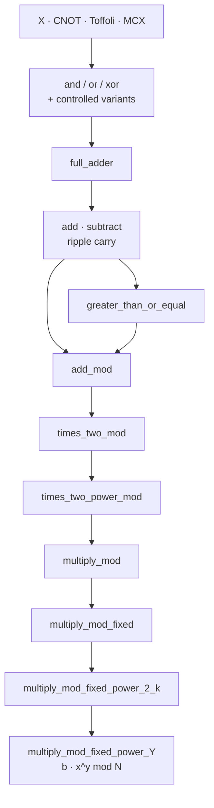

The final project for the Quantum Programming course I took during my Erasmus in Stockholm was to construct a quantum circuit that computes `b · x^y mod N`: modular exponentiation, the arithmetic subroutine at the core of Shor's factoring algorithm.

The implementation uses 26 qubits and approximately 1,500 operations for 2-bit operands. Few of those operations are quantum in the sense the term usually implies, and that is the subject of this note.

## Construction

The target operation is modular exponentiation. Given a modulus `N`, a base `x`, an exponent `y` and an initial value `b`, compute `b · x^y mod N`. In Shor's algorithm this operation dominates both the qubit count and the gate count; the period-finding procedure around it is small by comparison.

No library primitive implements it. Qiskit exposes gates only, so the arithmetic is built from the gate level upward:



Eleven layers. The lowest is a single logical gate:

```python
def or_gate(circuit, a, b, output):
    circuit.cx(a, output)
    circuit.cx(b, output)
    circuit.ccx(a, b, output)
```

Three gates are required for one reversible OR, because the operation must not discard information. A full adder is five such blocks and three scratch qubits. An n-bit addition chains n full adders through a carry. A modular addition is an addition, a comparison and a conditional subtraction. A modular doubling is a modular addition of a value with itself. A multiplication is a sequence of shifted conditional additions; this implementation recomputes each shift, so it performs a quadratic number of doublings. Modular exponentiation is n multiplications. The resource cost is the composition of these layers.

## Gate set

The complete set of quantum operations in the implementation is `x`, `cx`, `ccx`, `mcx`, `reset`, `barrier` and `measure`. There is no Hadamard, phase gate or rotation.

The circuit therefore never creates superposition or entanglement: every register holds a definite computational-basis value at every point. It is a classical reversible boolean circuit executed on a quantum simulator. In Shor's algorithm the superposition is generated outside the arithmetic. A single Hadamard layer prepares the exponent register in a uniform superposition of all exponents, and a Fourier transform at the end performs the interference. Both steps are quadratic in the bit width and negligible in cost relative to the arithmetic.

The arithmetic on a quantum computer is consequently more expensive than its classical equivalent, not less, because every operation must be made reversible.

## Scratch space

The measured cost of the completed circuit, for the worst-case exponent, is:

| bit width | qubits | total ops | resets | share |
| --- | --- | --- | --- | --- |
| 2 | 26 | 1,571 | 1,204 | 76.6% |
| 4 | 46 | 15,793 | 11,136 | 70.5% |
| 8 | 86 | 206,033 | 135,616 | 65.8% |

For 2-bit operands the circuit uses 26 qubits and 1,571 operations; 1,204 of these (76.6%) are resets.

In classical code a temporary variable is allocated and overwritten freely. A reversible circuit permits neither. Overwriting destroys information and is not reversible, and the qubit budget is fixed when the circuit is constructed. Every intermediate value requires a pre-allocated scratch register that is returned to `|0>` before reuse. The scratch requirement of each function is carried in a comment and derived from the layer beneath it:

```python
def multiply_mod(circuit, N, A, B, R, AUX):
    # Needs len(AUX) = 6 * len(A) + 6
```

Every function in the tower has such a line, up to `9 * len(X) + 6`. The values are established by hand and are not checked at runtime: a scratch register one qubit too short produces no error, only an incorrect result. The comparator, `greater_than_or_equal`, is correct only because the `subtract` it calls does not reset its scratch register at the end, leaving the carry-out available for reading. That dependency is recorded in a comment.

Resource accounting is the architecture of the implementation, not a byproduct of it.

## `reset` and measurement

`reset` is not a unitary gate. It measures the qubit and conditionally sets it to `|0>`, discarding the outcome. This is admissible in the present circuit only because no qubit is ever in superposition: every register holds a definite classical value, so the measurement does not disturb the state.

Within Shor's algorithm the same operation is invalid. There the arithmetic acts on an exponent register in superposition, and the scratch qubits become entangled with the result. Measuring them, even without reading the outcome, collapses the superposition and destroys the interference the algorithm depends on. The circuit would produce noise.

The correct construction is uncomputation: apply the arithmetic, copy the result out with CNOTs, then apply the inverse arithmetic to return every scratch qubit to `|0>` without measuring it. This costs approximately twice the gates and is not optional in the algorithmic context. The 1,571 operations are not a reduced form of the Shor subroutine; they belong to a different circuit.

## Classical control

The exponentiation loop is:

```python
for i in range(len("".join(reversed(Y)))):
    if Y[i] == "1":
        multiply_mod_fixed_power_2_k(circuit, N=N, X=X, B=B, AUX=AUX, k=i)
```

The branch `if Y[i] == "1"` is a Python conditional evaluated at circuit-construction time, because the exponent is a classical string. In Shor's algorithm the exponent is a quantum register in superposition, so no such branch exists. Each multiplication becomes a controlled operation whose control is the corresponding exponent qubit, and all are applied unconditionally. This is the distinction between a circuit that computes modular exponentiation and a circuit usable as the exponentiation subroutine in Shor's algorithm.

One classical precomputation is valid:

```python
W = pow(int(X, 2), 2**k, int(N, 2))  # classical CPU, at build time
```

The base is squared on the classical CPU because `x` and `N` are public constants and are not in superposition; each quantum step therefore reduces to a multiplication by a known constant. This is the standard construction.

A third shortcut appears as commented-out code in `multiply_mod_fixed`. The complete operation should end with a multiplication by the modular inverse of `x`, which is what makes it in-place and reversible. This implementation stops before it, on the ground that the result is already in `B` and is measured immediately. The omission is valid only under that measurement and fails if the operation is composed into a longer reversible circuit. The helper referenced by the removed code, `invert_string`, computes a bitwise complement, not a modular inverse.

## Resource estimates

The construction uses `10n + 6` qubits. For a 2048-bit RSA modulus this gives 20,486 logical qubits, with an extrapolated operation count on the order of 10¹⁴. The extrapolation is crude; the exponent is not sensitive to the constant.

Lower-cost constructions exist. Beauregard (2002) fits Shor's algorithm in `2n + 3` qubits by performing the arithmetic in the Fourier basis and reusing scratch space aggressively, a factor of five fewer qubits. Gidney and Ekerå estimate approximately 20 million physical qubits and 8 hours of runtime for RSA-2048, the physical count reflecting the error-correction overhead carried by each logical qubit.

The 26-qubit circuit runs on a simulator, where qubits are noiseless, reset is free and gate count costs only runtime. The tests reflect the same assumption: the low-level gate tests use 1,024 shots, and the high-level arithmetic tests use one, since a circuit without superposition is deterministic.

One gate test has its assertions outside the test loop, so it verifies only the final case. It passes.

## Implications

Two applications require qualification. Machine learning is often cited first, but encoding a classical dataset into amplitudes can cost more than the speedup returns, and the complexity results typically assume that cost away. Simulating quantum systems — chemistry, materials, catalysis — is the application the hardware is shaped for and rests on a stronger argument.

The immediate consequence for engineering is cryptographic. The relevant threat is retroactive: encrypted traffic captured today can be decrypted once a sufficiently large quantum computer exists, so the migration deadline is not the arrival date but that date minus the required secrecy lifetime of the data. This is the reason NIST standardised its post-quantum algorithms in August 2024 and places RSA and elliptic curve on a deprecation path around 2030.

The resulting problem is an inventory problem: locating RSA usage in existing systems, determining whether TLS termination can negotiate a hybrid key exchange, whether firmware signing keys can be rotated, and what hardware vendors will ship in three years. None of this requires knowledge of the Toffoli gate.

## Conclusions

Three observations follow, none of them about qubits.

**The advertised primitive is not the resource bottleneck.** Superposition and entanglement make the algorithm possible and account for two thin layers at the edges of the circuit. The determining cost is ripple-carry addition.

**A correct result is scoped to an unstated invariant.** The circuit returned correct values for every input tested while using an operation that would destroy the algorithm it is intended to serve. Nothing in the output indicates this. The relevant question about a shortcut is which invariant it assumes and whether that invariant still holds in the surrounding context.

**A fixed resource budget becomes the design.** Each function signature carries its scratch requirement, and the maximum computable problem is set by that budget rather than by the algorithm. The same constraint governs embedded code, GPU kernels and any system with a hard memory bound.

The circuits, the arithmetic tower and the tests are on GitHub: [github.com/nicolasguarini/qprog-modular-exponentiation](https://github.com/nicolasguarini/qprog-modular-exponentiation).
