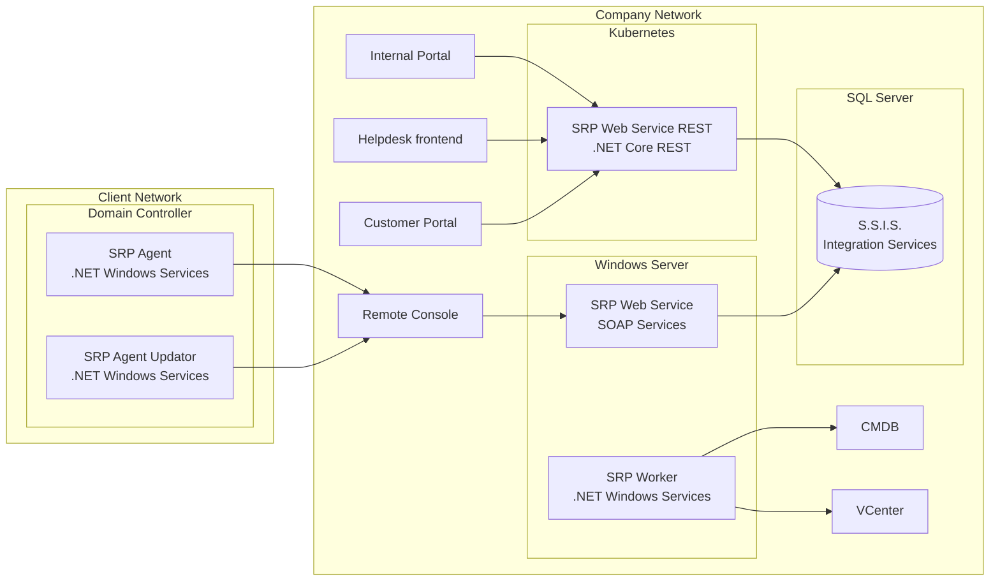
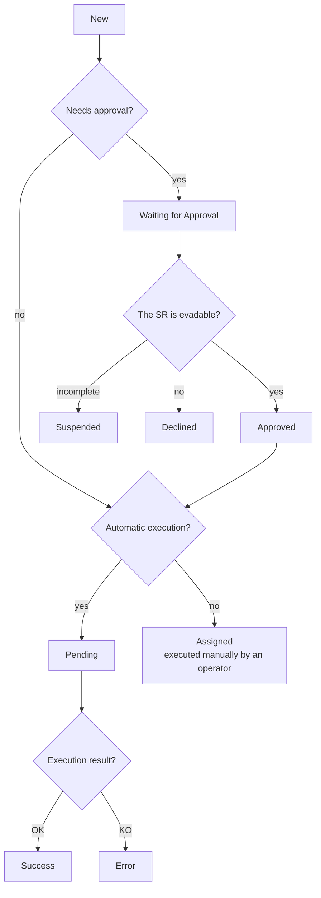
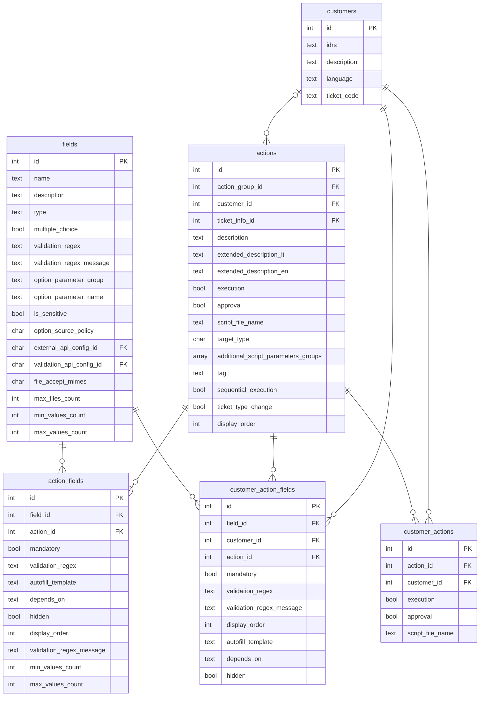
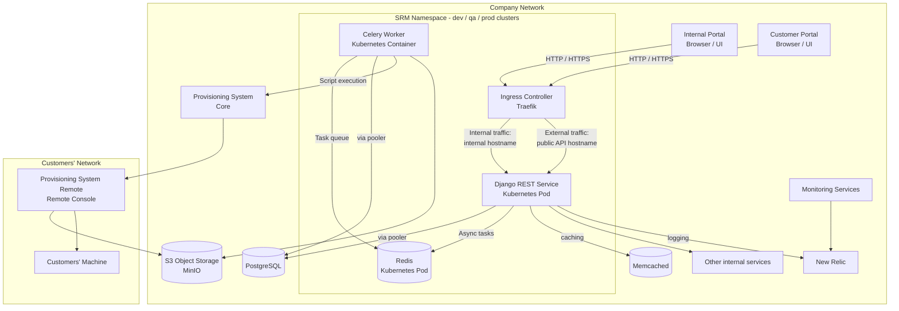
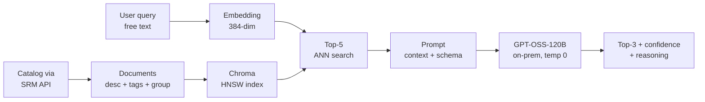

My master's thesis was about a rewrite. Not a greenfield project with an empty repository and a design document, but the more common case: migrating a system that has been in production for over a decade, used daily by several hundred companies, onto an architecture intended to last the next decade.

The system is the Service Request Portal (SRP). It is how the company's customers request operations on their own IT infrastructure: create an Active Directory user, reset a password, add a user to a VPN group, provision a mailbox, reserve a DHCP lease. A customer submits a form, a ticket is opened in the helpdesk system, and a PowerShell script eventually executes inside that customer's network. The catalog contains over four hundred distinct operations, across customers ranging from mid-size manufacturers to large retail brands.

The subject of the project was never the new stack. Django, Kubernetes, Ansible and PostgreSQL are implementation choices; once made, the rest is execution. The determining factor was the set of components that could not be modified, and the degree to which the final architecture was shaped by that set rather than by any principle of good design.

## Where the business logic ended up

The first month was spent mapping the system. SRP is not a single program but a distributed monolith: a .NET REST service on Kubernetes; a SOAP service and a Windows worker on a single Windows Server; a SQL Server instance hosting both the data and a large part of the business logic; and an agent installed on every customer's domain controller.



*The legacy architecture. The boundary between the company network and the client network is crossed only in one direction, from the agent to the company.*

A consistent pattern emerged: logic accumulates in whichever layer is least costly to change. This was never a decision; it was the cumulative result of many deadlines.

Form rendering logic ended up in the frontend, because that was the layer where a developer could ship a fix within a day. The result was a single Vue 2 component of nearly eleven thousand lines, a long chain of conditionals keyed on field descriptions:

```vue
<div v-if="field.desc == 'Domain'">
    ...
</div>
```

The snippet above is the problem in three lines. The backend returned almost no useful information about a field: a name, a mandatory flag, and a `type`. The `type` value therefore changed meaning from "which widget to render" to "which special case this is". By the time the project began there were 86 field types, many identical in behaviour and distinguished only by the service their options came from.

The consequence extended beyond the code. The people who configure the catalog are service delivery operators, not programmers. For them, "add a Domain field to this request" meant creating a field whose description was exactly the string `Domain` and whose type was exactly `domain`, because otherwise the Vue component would not recognise it. The configuration interface was, in practice, the source code of a frontend component that the operators could not read.

Data transformation logic ended up in SQL Server Integration Services packages, because that was where the DBA could work. State transition logic ended up in stored procedures, with hard-coded branches such as `IF @ParamName = 'ServerExc' BEGIN ...`. Neither was under version control. The SSIS packages resided on the database server and could only be edited through a remote desktop session: no history, no code review, no test environment, no rollback.

The database itself had no foreign keys. The relationships existed conceptually but were never declared, so nothing prevented a child row from referencing a parent that no longer existed. To this add heavy denormalisation, `IDGroup` next to `GroupID` in adjacent tables, and a table named `TBParamenters` that everyone had learned to spell wrong on purpose.

None of this reflects incompetence. Each decision was locally reasonable and shipped something that worked. Technical debt rarely arrives as a single bad decision; it arrives as hundreds of good decisions that were never revisited.

## The immovable parts

The constraints mattered more than any technology choice.

**The PowerShell scripts could not be modified.** Hundreds of them have been developed over years, tested and validated per customer, and maintained by a different department. The new execution flow had to run those scripts unchanged, with the same parameters, in the same kind of environment. This single constraint eliminated an entire category of solutions.

**The state machine could not be modified either.** A service request moves through states (`NEW`, `WAITING FOR APPROVAL`, `APPROVED`, `PENDING`, `ASSIGNED`, `COMPLETED`, `ERROR`, and a few more), and each state maps onto a specific state of the linked helpdesk ticket.



*The service request lifecycle. Technically unremarkable, organisationally load-bearing.*

The diagram could be redrawn on a whiteboard, but not changed, because it is not a technical artifact. It encodes accountability across three separate teams: the Managed Services team that configures the catalog, the Innovation team that builds the product, and the Customer Process Integration team that owns the ticketing system. Every transition is a handover assigned to a specific team. Changing the diagram means renegotiating the organisational structure, which is not a refactor.

**And the legacy catalog had to remain the source of truth** for the whole coexistence period, because it is what the operators knew how to edit and what the old system needed in order to keep running for the customers not yet migrated.

The design brief was therefore not "rewrite this system" but "rewrite everything except the scripts, the workflow and the authoritative data". This constraint narrowed the scope to two areas that remained open to redesign: how configuration is represented, and how execution is dispatched.

## Configuration as data instead of code

The central change was to represent field behaviour as backend data rather than frontend code. Instead of a `type` string that the frontend interprets, the API now returns everything needed to render and validate a field:

```json
{
  "field": {
    "name": "manager",
    "type": "select",
    "option_source_policy": "EXTERNAL_API",
    "external_api_config": {
      "endpoint_pattern": "api/customer/{{customer}}/adusers?domain={{domain}}",
      "response_mapping_json": { "name": "userDesc", "value": "user" },
      "is_searchable": true
    }
  },
  "mandatory": false,
  "validation_regex": "^[a-zA-Z0-9._]{5,20}$",
  "validation_regex_message": "Invalid format for Manager field.",
  "autofill_template": "{{ first_name }}.{{ last_name }}",
  "depends_on": ["domain", "first_name", "last_name"],
  "display_order": 26
}
```

Autofill is a Jinja2 template. Dependencies between fields are a list of names. The option source is a declared policy with a configuration object behind it. The frontend's responsibility reduces to reading a JSON description of a form, rendering it, and enforcing the rules it is given. Eighty-six special-cased types became ten render types, and the component went from roughly eleven thousand lines to about one thousand.

The harder problem was customisation. These are large enterprises, and each wants something slightly different: two extra fields, a stricter validation regex, a different autofill pattern, a domain list of its own. The old system handled this by duplicating actions, which is why the catalog had grown to hundreds of near-identical entries. Changing one behaviour for everyone meant finding every copy, and missing one was routine.

The replacement is a three-level resolution hierarchy. A `Field` carries the generic definition. An `ActionField` overrides it for a specific action. A `CustomerActionField` overrides that for a specific customer. The same pattern applies one level up, where `CustomerAction` overrides `Action`. Resolution walks from most specific to least, and no override ever mutates the layer below it.



*The three-level configuration hierarchy. `fields` and `actions` hold the defaults, the join tables hold the overrides.*

This model is familiar from CSS, including its failure mode: specificity is easy to add and hard to reason about later. The mitigation is that overrides are rows in a database rather than statements in a file, so they can be listed, diffed and validated. Consistency checks catch impossible configurations before a customer encounters them, for example an action configured to run on a machine selected by a field the action does not have.

## Deleting the agent

The other half of the rewrite was execution. In the old flow, an agent installed on each customer's domain controller polled the company network every few minutes for pending requests for its domain, downloaded the matching PowerShell script, ran it, and watched a log file for a completion marker. A separate agent watched the first agent's folder for a file with a `.new` extension in order to update it.

This design had three problems, in increasing order of severity. It was slow, because polling is inherently slow. It was operationally expensive, because every new customer domain required installing and maintaining another agent. And it required credentials with domain-admin privileges on the customer's own domain controller, which customers are increasingly unwilling to grant.

The replacement uses the company's internal provisioning system, which runs Ansible playbooks against remote machines. Ansible is agentless: it connects over SSH or WinRM, protocols already present on the targets. The playbook wraps the unmodified PowerShell script in a five-phase pattern (prepare, transfer, execute, collect logs, clean up) and uploads the execution log to an S3-compatible bucket, so logs no longer reside on whichever machine ran the job.



*The new architecture. Django and Celery in a Kubernetes namespace, Ansible-based provisioning crossing into the customer network, execution logs going to object storage.*

Two details in the diagram are worth noting. First, the target machine is no longer implicitly the domain controller. Where a script runs is now a configured property of an action, resolved through a strategy per target type, which allows some requests to run on an Exchange server, some on internal workers, and some on customer machines. Second, the diagram shows Redis as the Celery broker, which was accurate at design time but changed in production.

## Migrating without a flag day

A system like this cannot be replaced in a single deployment. The migration is per-action, controlled by a single enum on the action model:

```python
is_srp_flow: bool = action.target_type == ActionTargetTypes.SRP.name

response_ticket: dict = mysupport.create_ticket(...)  # both flows

if is_srp_flow:
    # legacy: SRP will create the request record itself
    return ServiceRequest(action=action, customer=customer, ticket_reference=ticket_id)
else:
    # modern: persist and hand off to Celery
    service_request = super().create(validated_data)
```

This is the entire coexistence strategy: a feature flag with a granularity of one action for one customer, and a rollback that is an `UPDATE` statement. Ticket creation is shared, so neither the frontend nor the customer can distinguish the two paths.

The order of deployment proved significant. The frontend went to production first, in front of the legacy backend, so every customer immediately received the improved form rendering and validation while their requests still executed through the old pipeline. This decoupled the risky half of the change from the visible half, and produced user feedback on the new interface months before the new execution flow carried any traffic.

Three observations from production were not apparent during the design phase:

The nightly catalog sync from SQL Server into PostgreSQL originally deleted and recreated everything, taking around two hours. Rewriting it as a differential sync (load existing rows into a dictionary keyed by primary key, split incoming records into create and update lists, `bulk_create` and `bulk_update` with a batch size) reduced it to roughly twenty seconds. The algorithm is not clever; it simply stopped doing unnecessary work, which is the source of most performance improvements.

Redis was the wrong broker. It was a defensible choice on paper: sub-millisecond delivery, trivial operations, transparent introspection with `redis-cli`. The failure case is a broker restart while a request is enqueued. A service request whose database row says `PENDING` and whose task no longer exists anywhere is a silent failure, discovered days later when a customer asks why nothing happened. RabbitMQ provides publisher confirms, consumer acknowledgements, durable queues and dead letter exchanges, and switching cost almost nothing because Celery abstracts the broker. The conclusion is not that Redis is unsuitable in general, but that development environments favour the properties that are immediately visible (speed, simplicity) while production requires the properties that only surface under failure.

The action detail endpoint was slow because it did too much. It pre-computed everything the form could need, including several external API calls to fetch ticket classification options, before returning: three to five seconds. The fix was to return the core action and field configuration immediately and let the frontend fetch classification options after the form rendered, reducing the median to under 500 ms. Backend validation of those fields was unchanged, since moving work off the critical path is not the same as trusting the client.

As of the beginning of this year the new system runs in production for a first cohort of customers, with the old one still serving the majority, and the plan targets decommissioning by the end of Q2 2026.

## Four hundred actions is a search problem

One part of the thesis was not a rewrite of anything, and it followed from a direct observation: the flexible catalog just built makes discovery harder. Over four hundred actions, organised into types, categories and groups, form a clean data model but an unusable menu.

A user who wants a mailbox for a new hire must know that it lives under the `Personal` type, then the Exchange category, then the mailbox group. That taxonomy exists for administrative reasons and assumes the user reasons like the IT department. Users do not; they type "the new guy needs email".

The final chapter is a retrieval-augmented generation service that maps free-text intent onto catalog actions. The pipeline is deliberately unremarkable:



FastAPI in front, LangChain in the middle, an on-premise GPT-OSS-120B behind it. The model runs inside the company network because these queries contain customer names, usernames and infrastructure details, none of which should leave the network to reach a third-party API.

Two design decisions are worth stating. First, retrieval is not an optimisation here; it is the correctness mechanism. An unaugmented model asked to select an action from a catalog it has never seen will invent a plausible one, and a confidently hallucinated `Delete User Account` is a serious defect, not a cosmetic one. Constraining the model to rank five retrieved candidates limits the space of possible answers to a subset of actions that exist.

Second, every recommendation carries a confidence score and a short written justification. This is not presentational. In an enterprise context where the recommended operation may create an account or grant a permission, the user must be able to detect a misunderstanding before submitting, and it must be possible to reconstruct afterwards why a suggestion was made.

## Evaluation

A 200-example labelled dataset was assembled: 150 real queries from pilot customers who consented to logging, plus 50 written by hand to cover the Network and System categories that real traffic barely used. The real queries were shorter than expected (median 8 tokens), 75% in Italian, and about a fifth embedded the request inside a paragraph of context, ticket numbers included.

The final configuration reaches 78.6% accuracy at rank 1 and 81.0% at rank 3, up from 62.3% for the first version. The improvements came from three rounds of measurement: removing stopwords and switching to a multilingual embedding model; halving the chunk size and normalising the vectors; and retrieving five candidates instead of three with a similarity floor to keep irrelevant entries out of the prompt. The Italian subset alone went from 54% to 68% in the first round, a change that is not visible without a stratified dataset.

The most useful number is the gap between accuracy@1 and accuracy@3, because it is small: 2.4 points. One would expect a ranker to be roughly correct and occasionally place the right answer second or third; instead, when this system is wrong, the correct action is usually not in the candidate set at all. This reframes the improvement plan. Better prompting would contribute almost nothing; the bottleneck is retrieval, which points to hybrid dense and sparse search, query expansion, and improved catalog descriptions.

The per-category numbers are similarly counterintuitive. System actions score 88%, Network 78%, and `Personal`, which is 85% of real traffic, scores 68%. Technical queries carry discriminating vocabulary: "Firewall", "VPN" and "DHCP reservation" are nearly unambiguous, whereas "Set up the new employee" is not, and the catalog places `Create User Account`, `Create User with Mailbox` and `Create User with Office 365 License` next to each other. The system performs worst exactly where it is used most, a reminder that an aggregate accuracy figure can hide the only distribution that matters.

Shipping a feature at 78.6% required a justification, and it is not that the number is high. It is that the failures are well bounded. Wrong recommendations remain close to the intent: the failure mode is `Create User` instead of `Create User with Mailbox`, not `Configure Firewall Rule`. When a user selects a suggestion, the interface shows the full extended description in their language, so "this action permanently removes the user from Active Directory" appears before anything is submitted. An explicit notice states that the suggestions come from a model and should be verified. The old hierarchical browser remains available, unchanged, because the feature is an accelerator and not a gate.

## Conclusions

Three observations, none of them specific to Django.

Logic accumulates wherever it is cheapest to write, not where it belongs. An eleven-thousand-line frontend component and a stored procedure full of hard-coded `IF` branches are the same phenomenon in two languages. For configuration to remain configuration, adding a row must be more convenient than adding a branch, and that is a property of the tooling rather than of the team's discipline.

The immovable constraints determine the design. In any modernisation project the technology is easy to list; the useful question is which parts are frozen and why, because a constraint that exists for organisational reasons will outlast several architectural preferences. Determining early which components are load-bearing for other teams' accountability is worth more than any framework comparison.

A metric that cannot be broken down is not yet understood. Aggregate accuracy indicated the recommender was adequate; splitting it by rank showed the improvement plan targeted the wrong component, and splitting it by category showed the worst performance sat on top of the heaviest traffic. Both changed the next steps, and neither was visible in the headline number.

The thesis itself, diagrams and bibliography included, is on GitHub: [github.com/nicolasguarini/master-thesis](https://github.com/nicolasguarini/master-thesis).
